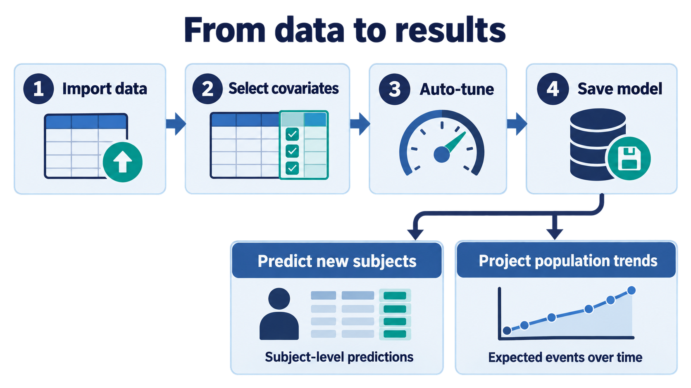
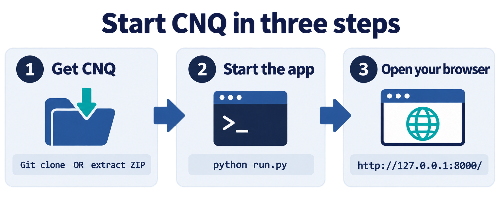

# CNQ App

A browser app for **censored non-crossing quantile regression**: predict the full survival-time distribution for each subject.
It opens in your web browser, but the app and your data stay on the machine it runs on: your own Google Cloud virtual machine (recommended) or your own computer. Your data is never uploaded anywhere else.

First-time setup takes about 10 minutes.

---

## Run on Google Cloud (Vertex AI Workbench)

1. **Google Cloud Console → Vertex AI → Workbench.** Select your instance (start it if it's stopped), then click **Open JupyterLab**.
2. **First time only** — open a terminal in JupyterLab (**File → New → Terminal**) and download the app:
   ```
   git clone --recursive https://github.com/IsaacPan1/Deepcnq_app
   ```
3. **Start CNQ** from the same terminal:
   ```
   cd ~/Deepcnq_app/cnq_app
   python run.py 8000
   ```
   The first time, it installs what it needs, which takes a few minutes. Wait until you see:
   ```
   Serving CNQ app on 127.0.0.1 port 8000
   ```
4. **Open the app.** Take your JupyterLab address and replace `/lab` with `/proxy/8000/`. For example, if JupyterLab is at
   `https://abc123-dot-us-central1.notebooks.googleusercontent.com/lab`, open:
   ### `https://abc123-dot-us-central1.notebooks.googleusercontent.com/proxy/8000/`
   Keep the trailing slash.

Keep the terminal open while you use the app. To stop it, click the terminal and press **Ctrl+C**.

> **8000 can be any number.** If that number is already in use, CNQ prints a one-line message. Just start it on a different number, for example `python run.py 8001`, and use that **same number in the link** (`.../proxy/8001/`).

### Load your own data

There are two ways to load a CSV, both available on the **Train** and **Predict** tabs:

1. **Upload from your own computer.** Drag a file onto the upload box, or click it to pick one. This sends the file from your computer through your browser, so it is fine for small files and is capped at **64 MB**.
2. **Use a file already on the VM.** This suits real or large data. Upload the CSV into JupyterLab (the upload icon ↑ in the file browser on the left, or drag it into that panel), right-click the uploaded file and choose **Copy Path**, then paste that path into the **"or paste a file path"** field next to the upload box and press Enter or click **Load from path**. CNQ reads it straight from the VM's disk, so there is no 64 MB limit, and if the data already lives on the VM it never needs to be downloaded to your computer.

### Your data stays on your VM

- **The app only exists on your own VM, and only while you have it running.** The link doesn't work on any other machine, and it stops working when you stop the server (Ctrl+C) or stop the instance.
- **It is not a public link.** Opening it requires signing in to Google with an account that has access to your instance. By default that is only you. If you give colleagues access to your instance in Google Cloud they can open it too, and you would share the same files, so give each person their own instance.
- **Your data stays on the VM.** Files you upload to JupyterLab are read from the VM's disk and copied into `cnq_app/jobs/uploads` on that same VM. Nothing is sent anywhere else.
- **Other people can use port 8000 at the same time.** They are on their own VMs, so there is no clash and nothing is shared with you.

### What is saved

- **Saved models are kept.** A model you save (a `.cnqmodel` file in `cnq_app/models/`) is still listed on the **Predict** tab whenever you reopen the app. It survives stopping the server, restarting the instance and `git pull`. It is only removed if you delete it in the app or delete the `Deepcnq_app` folder (or the instance).
- **Download results when a run finishes.** Reports, plots and predictions from your 20 most recent runs stay on disk in `cnq_app/jobs/`, but after you restart the server the app no longer lists past runs. Download the predictions CSV, report or zip when the run completes.

### Open it again later

Open JupyterLab (start the instance first if it was stopped), open a terminal and run:

```
cd ~/Deepcnq_app/cnq_app
python run.py 8000
```

Then open the same `/proxy/8000/` link. To get the latest version first, stop CNQ and run `cd ~/Deepcnq_app && git pull --recurse-submodules`. New packages install automatically.

---

## Typical workflow



Import your data, choose the covariates, let Auto-tune find suitable settings, and save the trained model. You can then use that model to predict outcomes for new subjects or project population-level trends.

---

## Preparing your data

Upload **one CSV file** with **one row per subject**:

| Column | Format |
|---|---|
| Follow-up time | Number greater than 0, same unit for every row (days, months...) |
| Event | `1` = event happened, `0` = censored |
| Covariates | Numbers only; categories as 0/1 columns |
| Subject ID *(optional)* | Any unique value |

No blank cells in the columns you use. A sample dataset and a template are available in the app.
More details are in [`cnq_app/README.md`](cnq_app/README.md).

---

## Run on your own computer (Windows / Mac)

Prefer your own laptop? It is the same app, and your data stays on your computer.



### 1. Install Python and Git (one time only)

**Python 3.11:** https://www.python.org/downloads/release/python-3119/
(scroll down to *Files* and pick the Windows or macOS installer)

> **Windows:** on the first installer screen, tick **"Add python.exe to PATH"**.

**Git**
- **Windows:** install from https://git-scm.com/download/win (the default options are fine)
- **Mac:** Git is installed automatically the first time you run `git`. If a window asks to install "command line developer tools", click **Install**.

### 2. Download the app

Open a terminal:

- **Windows:** Start menu → type `cmd` → press Enter
- **Mac:** Cmd+Space → type `Terminal` → press Enter

Copy and paste:

**Windows**
```
cd /d %USERPROFILE%
git clone --recursive https://github.com/IsaacPan1/Deepcnq_app
```

**Mac**
```
cd ~
git clone --recursive https://github.com/IsaacPan1/Deepcnq_app
```

This creates a `Deepcnq_app` folder in your home folder.

### 3. Start the app

**Windows**
```
cd /d %USERPROFILE%\Deepcnq_app\cnq_app
python run.py
```

**Mac**
```
cd ~/Deepcnq_app/cnq_app
python3 run.py
```

The first time, it downloads what it needs, which takes a few minutes. Wait until you see:

```
Serving CNQ app on 127.0.0.1 port 8000
```

### 4. Open the app

Open this address in your browser:

#### http://127.0.0.1:8000/

- Keep the terminal window **open** while you use the app.
- To stop the app, click the terminal and press **Ctrl+C**.

### Open it again later

Open a terminal and paste:

**Windows**
```
cd /d %USERPROFILE%\Deepcnq_app\cnq_app
python run.py
```

**Mac**
```
cd ~/Deepcnq_app/cnq_app
python3 run.py
```

Then open http://127.0.0.1:8000/

### Update to the latest version

**Windows**
```
cd /d %USERPROFILE%\Deepcnq_app
git pull --recurse-submodules
```

**Mac**
```
cd ~/Deepcnq_app
git pull --recurse-submodules
```

Then start the app as usual. If new packages are needed, they install automatically.

For a very large file on your own computer you can also type its path into the **"or paste a file path"** field instead of dragging it in.

---

## Troubleshooting

**On Google Cloud (Workbench)**

| Problem | Fix |
|---|---|
| Blank page, or a generic "404: Not Found" / "Init failed" error | Use the address ending in `/proxy/8000/` (or your port number) with the trailing slash, not `/lab`, then hard refresh with **Ctrl+Shift+R**. |
| "Port … is already in use" | Start CNQ on another number, for example `python run.py 8001`, and use that same number in the link (`/proxy/8001/`). |
| "Could not load that path" | The path must point to a file already on your VM (uploaded through JupyterLab's file browser), not a path on your own laptop. |
| The link stopped working | The server isn't running (the terminal was closed or the instance was stopped). Start the instance if needed, then run `python run.py 8000` again. |

**On your own computer**

| Problem | Fix |
|---|---|
| `git` is not recognized (Windows) | Install Git from https://git-scm.com/download/win, then open a **new** terminal. |
| `python` is not recognized (Windows) | Reinstall Python and tick **"Add python.exe to PATH"**, then open a **new** terminal. |
| "destination path 'Deepcnq_app' already exists" | You already downloaded it. Skip to *3. Start the app*, or see *Update to the latest version*. |
| "Repository not found" when starting the app | Run `git submodule update --init --recursive` inside the `Deepcnq_app` folder, then start again. |
| "Port 8000 is already in use" | Run `python run.py 8001` (Mac: `python3 run.py 8001`) and open http://127.0.0.1:8001/ |
| Page looks plain or buttons don't work | Use exactly `http://127.0.0.1:8000/`, then press **Ctrl+Shift+R** (Mac: **Cmd+Shift+R**). |
| Red banner about missing packages, or installation failed | Check your internet connection, then run `python run.py --reinstall` (Mac: `python3 run.py --reinstall`). |
| `No Python at ...` (a moved or uninstalled Python) | Delete the `.venv` folder inside `cnq_app` and run `run.py` again — it rebuilds the environment from scratch. |

Still stuck? [Open an issue](https://github.com/IsaacPan1/Deepcnq_app/issues) or contact **Isaac, your-email@unc.edu**.

---

## Citation

Huang S, Qu Z, Hua Z, Shen G, Tang R, Zhu H. *Non-crossing deep quantile regression for distributional survival prediction.* arXiv:2608.16864 (2026).
Method code: https://github.com/BIG-S2/deepcnq
